# Puyo Puyo 2: Mega Drive / Genesis English Translation

Port of `puyopuy2e` to the Mega Drive release **Puyo Puyo 2** (Japan, v1.1).
Besides everything shared with the arcade and [Saturn](README_SATURN.md) versions, the
Mega Drive menus and screens, which exist only on this cartridge, are redrawn in English.


## Base ROM

A raw 2 MB dump (no header):

| File | Size | CRC32 |
|---|---|---|
| `Puyo Puyo 2 (Japan) (v1.1).md` | 2,097,152 | `25b7b2aa` |

## Patch

Each [release](https://github.com/tbender4/puyopuy2e/releases) has
`puyopuy2e-md-no-red-puyos.ips` and a patcher for convenience.

#### Linux/macOS
```sh
./patch.sh "Puyo Puyo 2 (Japan) (v1.1).md" puyopuy2e-md-no-red-puyos.ips
```

#### Windows
```powershell
powershell -ExecutionPolicy Bypass -File .\patch.ps1 "Puyo Puyo 2 (Japan) (v1.1).md" puyopuy2e-md-no-red-puyos.ips
```

Both write `Puyo Puyo 2 (English) (v1.1).md` next to the original.

An IPS-capable patcher works as well.

## Build From Source

A Python script is available:

```sh
python3 make_puyopuy2e_md.py ["Puyo Puyo 2 (Japan) (v1.1).md" | FOLDER] [OUT_ROM]
```

The default input is this folder and the default output `Puyo Puyo 2 (English) (v1.1).md`
next to the input. `--logo` picks the title logo as for the other versions
(`no-red-puyos` default, `with-red-puyos`, `original`).

## What is translated

#### Shared with the arcade and Saturn versions
- title logo
- the 58 character profile pages and the 12 attract tutorial pages
- gameplay HUD (`CHAIN`, `OFFSET`, `K.O.`, `YAY!`)
- the tower (`PICK YOUR RIVAL`, Nomi's `I'M HERE`, `YAY!`, `HOORAY!` and `OUCH!`), `CONTINUE?`
- level select (`EXTRA MILD` ... `EXTRA HOT`)
- Act Against AIDS (`COURAGE AND LOVE`)

#### Mega Drive only
- mode select (`CHOOSE A MODE!` and the three Carbuncle mouths: `1 PLAYER PUYO`,
  `2 PLAYER PUYO`, `OPTIONS`)
- `PAUSE` and the 2P join-in banner (`CHALLENGER!`)
- 2P rule select (`CHOOSE A RULE!`) and its six rule descriptions
- Rule Edit menu and the rule editor (all settings and the nuisance hardness labels)
- `GAME OPTION` and the ending record romaji (`RULE SET`, `OFFSET`, `CHAIN LIMIT`,
  `MAX CHAIN`)

## Not translated

- The Japanese names in the ending staff roll, as in the arcade translation

## Screenshots

| | Original | English |
|---|---|---|
| Title |  |  |
| Act Against AIDS |  |  |
| Mode select |  | 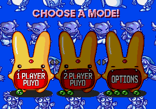 |
| Character profile |  |  |
| Continue | 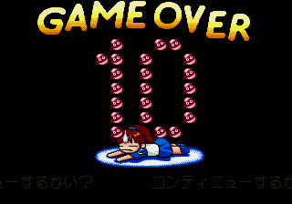 |  |
| 2P rule select |  | 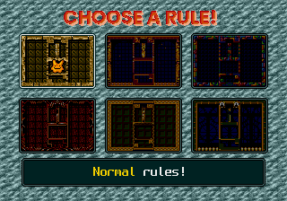 |
| Rule Edit menu | 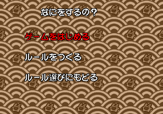 | 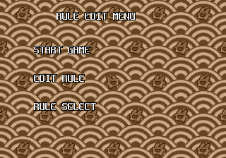 |
| Rule editor | 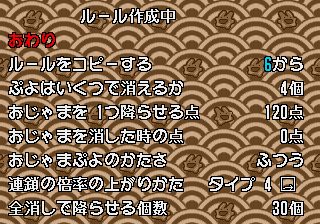 |  |
| Options | 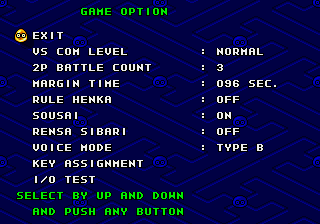 |  |
| Tutorial | 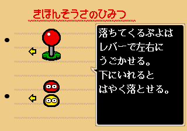 | 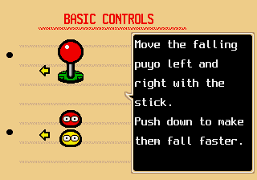 |
| Tutorial | 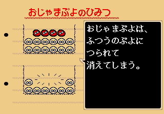 | 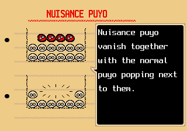 |
