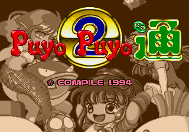
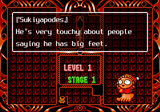
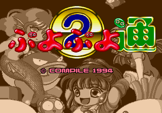
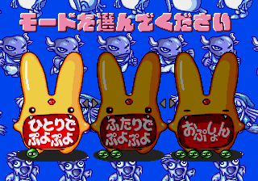
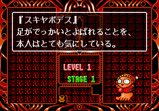
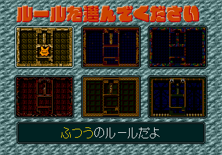
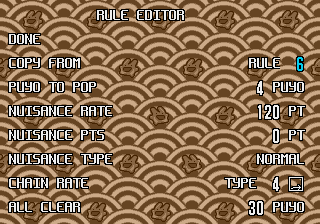
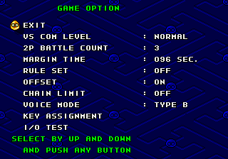
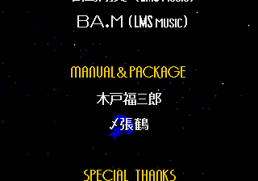

# Puyo Puyo 2: Mega Drive / Genesis English Translation

Port of `puyopuy2e` to the Mega Drive release **Puyo Puyo 2** (Japan, v1.1).
Besides everything shared with the arcade and [Saturn](README_SATURN.md) versions, the
Mega Drive menus and screens, which exist only on this cartridge, are redrawn in English.




## Base ROM

A raw 2 MB dump (no header):

| File | Size | CRC32 |
|---|---|---|
| `Puyo Puyo 2 (Japan) (v1.1).md` | 2,097,152 | `25b7b2aa` |

## Patch

Each [release](https://github.com/tbender4/puyopuy2e/releases) has
`puyopuy2e-md-rcN.ips` (N: the release candidate number) and a patcher for convenience.

### Linux/macOS
```sh
./patch.sh "Puyo Puyo 2 (Japan) (v1.1).md" puyopuy2e-md-rcN.ips
```

### Windows
```powershell
powershell -ExecutionPolicy Bypass -File .\patch.ps1 "Puyo Puyo 2 (Japan) (v1.1).md" puyopuy2e-md-rcN.ips
```

Both write `Puyo Puyo 2 (English) (v1.1).md` next to the original.

An IPS-capable patcher works as well.

## Build From Source

A Python script is available:

```sh
python3 make_puyopuy2e_md.py ["Puyo Puyo 2 (Japan) (v1.1).md" | FOLDER] [OUT_ROM]
```

The default input is this folder and the default output `Puyo Puyo 2 (English) (v1.1).md`
next to the input.

### Logo Customization
- `--logo` picks the title logo as for the other versions (`no-red-puyos` default, `with-red-puyos`, `original`).

## What is translated

### Shared with the arcade and Saturn versions
- title logo
- the 58 character profiles and the 12 attract tutorial pages
- gameplay HUD
- the tower and the continue screen
- level select
- Act Against AIDS

### Mega Drive only
- Mode select
- Pause and the 2P join-in banner
- 2P rule select and its rule descriptions
- Rule Editor
- Game options and the ending record
- The ending staff roll
  - credits sourced from [MobyGames](https://www.mobygames.com/game/13047/puyo-puyo-2/credits/genesis/)

## Screenshots

| | Original | English |
|---|---|---|
| Title |  |  |
| Act Against AIDS |  |  |
| Mode select |  |  |
| Character profile |  |  |
| Continue |  |  |
| 2P rule select |  |  |
| Rule editor |  |  |
| Options |  |  |
| Tutorial |  |  |
| Staff roll |  |  |
