# Puyo Puyo 2: Sega Saturn English Translation

Port of `puyopuy2e` to the Sega Saturn release **Puyo Puyo Tsuu** (`T-6601G`, V1.200).
Besides everything shared with the arcade and [Mega Drive](README_MD.md) versions, the
Saturn menus, cards and dialogs, which exist only on this disc, are redrawn in English.

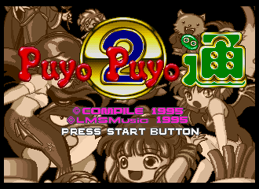


## Base disc

A raw `.bin`/`.cue` dump with two tracks; only Track 1 is changed:

| File | Size | CRC32 |
|---|---|---|
| `PUYO_PUYO_TSU____ (Track 1).bin` | 606,498,480 | `3f966f9d` |
| `PUYO_PUYO_TSU____ (Track 2).bin` | 1,764,000 | |

## Patch

Each [release](https://github.com/tbender4/puyopuy2e/releases) has
`puyopuy2e-saturn-rcN.bps` (N: the release candidate number) and a patcher for convenience.

### Linux/macOS
```sh
./patch.sh "PUYO_PUYO_TSU____ (Track 1).bin" puyopuy2e-saturn-rcN.bps
```

### Windows
```powershell
powershell -ExecutionPolicy Bypass -File .\patch.ps1 "PUYO_PUYO_TSU____ (Track 1).bin" puyopuy2e-saturn-rcN.bps
```

Both write `Puyo Puyo 2 (English) (Track 1).bin` and `Puyo Puyo 2 (English).cue` next to
the original.

A BPS-capable patcher works as well.

## Build From Source

A Python script is available:

```sh
python3 make_puyopuy2e_saturn.py ["PUYO_PUYO_TSU____ (Track 1).bin" | FOLDER] [OUT_DIR]
```

The default input is `saturn/` (the `.cue` and Track 2 must sit next to Track 1) and the
default output `dist/saturn/`.

### Logo Customization
- `--logo` picks the title logo as for the other versions (`no-red-puyos` default, `with-red-puyos`, `original`).
- `--fast` overlays onto an existing output Track 1 instead of copying 606 MB.

## What is translated

### Shared with the arcade and Mega Drive versions
- title logo
- the 12 attract tutorial pages
- gameplay HUD
- the tower
- 2P rule select
- mode select
- options romaji

### Saturn only
- The 1P difficulty cards and their descriptions
- Save file select, delete data, and the backup RAM and controller messages
- Rule Editor
- Tsuu mode character select
- The sound test's two bonus video titles
- The ending staff roll
  - credits sourced from [MobyGames](https://www.mobygames.com/game/13047/puyo-puyo-2/credits/sega-saturn/)

#### Cutscenes
The Saturn version has extensive "Manzi Demos" in both Normal and Tsuu modes. All 74 demos now have timed subtitles with English sprites. Notably:
- Nomi's signs
- Shezo's ヘンタイ / タイヘン signs keep the Japanese (the swap is the joke) with `PERVERT` / `TERRIBLE` above them
- Small signs and sound effects keep the Japanese along with an English subtext

`STORY DEMO` on OPTIONS page 2 has updated configuration options: 
  - `SUBTITLES`: English subtitles appear at the bottom (default),
  - `SPEAKER`: English subtitles appear next to whoever speaks
  - `SIGNS ONLY`: only translated on-screen signs, no voice subtitles.
  - `OFF`: no demos

#### Endings
All endings are subtitled on the bottom like `SUBTITLES` mode.

### Special Thanks

A bulk of the translations are from Domino054's [translated cutscene videos](https://youtu.be/aKZwf3sSVWM). Thank you for graciously permitting its use!

## Screenshots

| | Original | English |
|---|---|---|
| Title |  |  |
| Mode select | 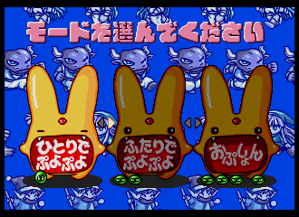 | 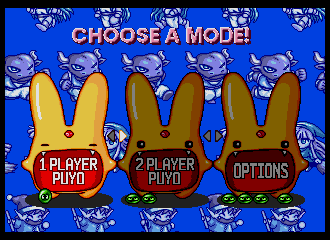 |
| 1P difficulty: Normal |  |  |
| Tsuu character select |  |  |
| Tower |  | 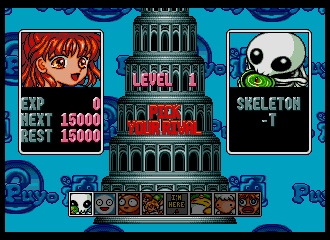 |
| Match won | 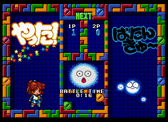 | 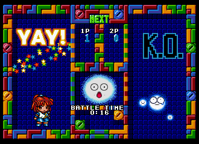 |
| Continue |  |  |
| 2P rule select | 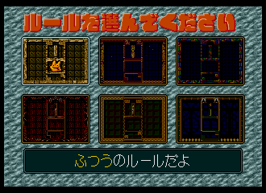 |  |
| Rule editor | 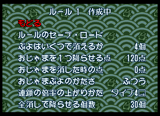 |  |
| Options page 2: `STORY DEMO` |  | 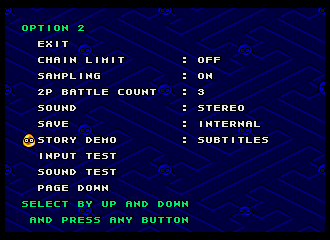 |
| Skit subtitles: `SUBTITLES` | 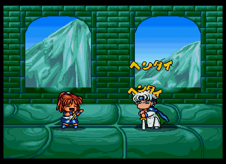 | 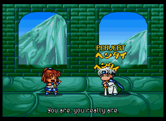 |
| Skit subtitles: `SPEAKER` |  |  |
| Tutorial |  | 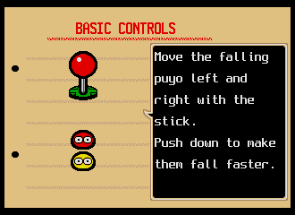 |
| Staff roll | 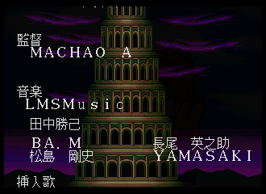 | 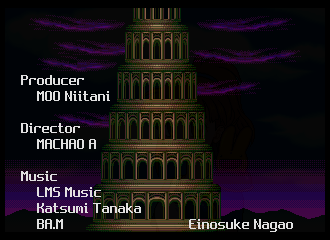 |
