# Puyo Puyo 2: Sega Saturn English Translation

Port of `puyopuy2e` to the Sega Saturn release **Puyo Puyo Tsuu** (`T-6601G`, V1.200).
Besides everything shared with the arcade and [Mega Drive](README_MD.md) versions, the
Saturn menus, cards and dialogs, which exist only on this disc, are redrawn in English.


## Base disc

A raw `.bin`/`.cue` dump with two tracks; only Track 1 is changed:

| File | Size | CRC32 |
|---|---|---|
| `PUYO_PUYO_TSU____ (Track 1).bin` | 606,498,480 | `3f966f9d` |
| `PUYO_PUYO_TSU____ (Track 2).bin` | 1,764,000 | |

## Patch

Each [release](https://github.com/tbender4/puyopuy2e/releases) has
`puyopuy2e-saturn-no-red-puyos.bps` and a patcher for convenience.

#### Linux/macOS
```sh
./patch.sh "PUYO_PUYO_TSU____ (Track 1).bin" puyopuy2e-saturn-no-red-puyos.bps
```

#### Windows
```powershell
powershell -ExecutionPolicy Bypass -File .\patch.ps1 "PUYO_PUYO_TSU____ (Track 1).bin" puyopuy2e-saturn-no-red-puyos.bps
```

Both write `Puyo Puyo 2 (English) (Track 1).bin` and `Puyo Puyo 2 (English).cue` next to
the original.

A BPS-capable patcher works as well.

## Build From Source

A Python script is available:

```sh
python3 make_puyopuy2e_saturn.py ["PUYO_PUYO_TSU____ (Track 1).bin" | FOLDER] [OUT_DIR]
```

The default input is `saturn/` (the `.cue` and Track 2 must sit next to Track 1) and the
default output `dist/saturn/`. `--logo` picks the title logo as for the other versions
(`no-red-puyos` default, `with-red-puyos`, `original`); `--fast` overlays onto an existing
output Track 1 instead of copying 606 MB. Every translated file is written back in place
inside its original disc sectors, so the image keeps its size and layout.

## What is translated

#### Shared with the arcade and Mega Drive versions
- title logo
- the 12 attract tutorial pages
- gameplay HUD (`CHAIN`, `OFFSET`, `K.O.`, `YAY!`)
- the tower (`PICK YOUR RIVAL`, Nomi's `I'M HERE`, `YAY!`, `HOORAY!` and `OUCH!`), `CONTINUE?`, `PAUSE`,
- 2P rule select (`CHOOSE A RULE!`)
- mode select (`CHOOSE A MODE!`, with the Saturn-only fourth mode, `ENDLESS PUYO`)
- options romaji (`RULE SET`, `OFFSET`).

#### Saturn only
- The 1P difficulty cards and their descriptions (`PRACTICE`, `NORMAL`, `TSUU`)
- Save file select (`NEW GAME` slots), delete data, and the backup RAM and controller
  messages
- Rule Edit menu, the rule editor (all settings and the nuisance hardness labels) and the
  rule slot save and load boxes
- Tsuu mode character select (`START!`) and Nomi on the BEST RECORDS screen
- The sound test's two bonus video titles
- The ending staff roll: roles and every name as [MobyGames](https://www.mobygames.com/game/13047/puyo-puyo-2/credits/sega-saturn/)
  credits them (credited aliases kept as aliases)

## Not translated yet

These are Game Arts' own files, in other formats, planned as Milestone D:

- The voiced manzai skits between matches (their captions and sound-effect lettering)
- The `30分経過` ("30 minutes later") caption
- The Saturn Act Against AIDS card in attract mode

The voice audio and the FMV videos are left as they are.

## Screenshots

| | Original | English |
|---|---|---|
| Title | 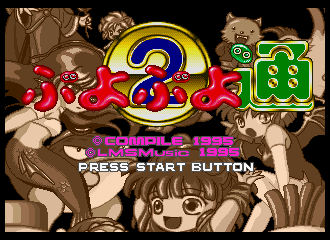 |  |
| Mode select |  |  |
| 1P difficulty: Normal |  |  |
| 1P difficulty: Practice |  |  |
| 1P difficulty: Tsuu | 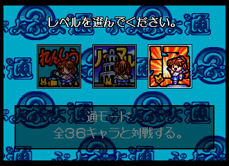 | 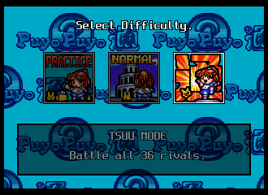 |
| Save file select | 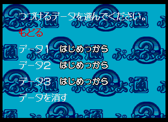 |  |
| Tsuu character select | 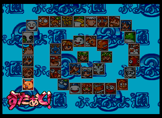 | 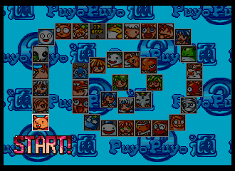 |
| Tower |  |  |
| Match won |  |  |
| Continue | 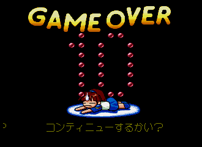 | 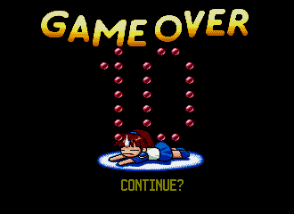 |
| 2P rule select |  | 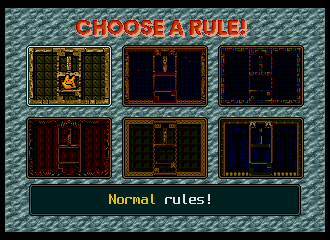 |
| Rule Edit menu | 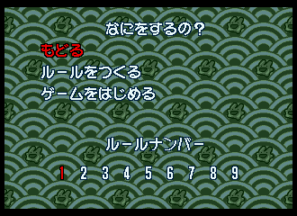 |  |
| Rule editor |  | 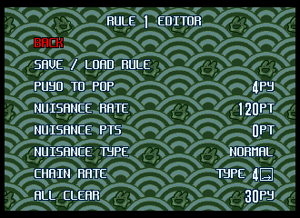 |
| Rule save | 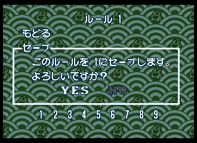 | 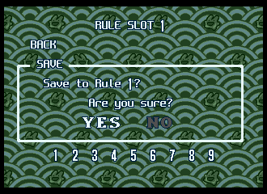 |
| Options |  | 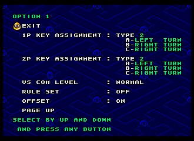 |
| Tutorial |  |  |
| Tutorial | 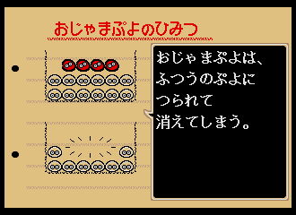 | 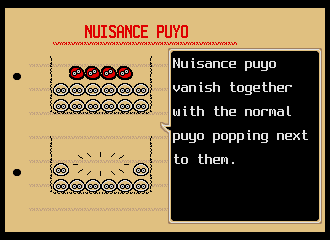 |
| Staff roll |  |  |
